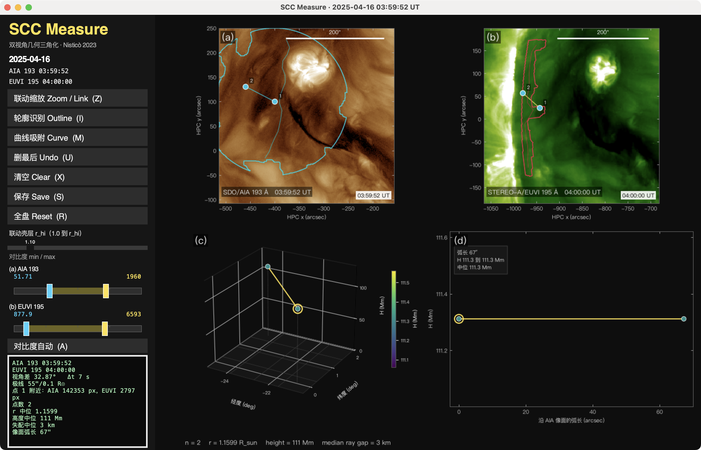
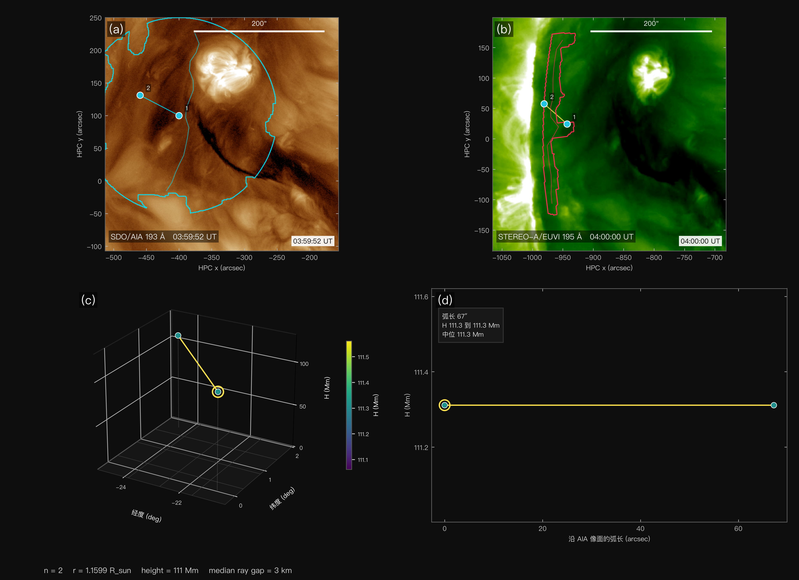
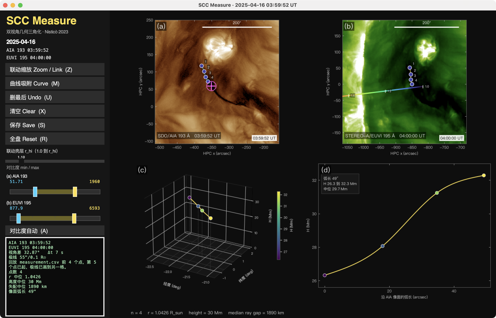

# QLS-SCC

QLS 风格的双视角 SCC 三角化工作台。把 SDO/AIA 与 STEREO-A/EUVI 两幅像放在同一个界面里，
点选同一条结构的对映点，实时给出 HEEQ 三维位置、高度随弧长的分布，并保存 PNG、PDF、JSON 与 CSV。

方法来自 Nisticò (2023) 的几何三角化。界面沿用作者 QLS 四格模板，并吸收了 pcp3 平行测试里
的视场联动与平滑曲线吸附。



2025-04-16 的 193/195 例子，见 [examples/20250416](examples/20250416)。



## 特性

- **四格布局**，(a) 参考视角、(b) 另一视角、(c) 经度-纬度-高度三维图、(d) 高度随弧长的分布。
- **视场联动**，在任一格框选，另一格按 1.0 到 r_hi 的三维壳层跟到同一片区域。
- **平滑曲线吸附 Curve**，用已测点拟合曲线，与当前极线求最近点，替你对映点。
- **任一格起点**，先从 AIA 或先从 EUVI 都可以，另一格自动画极线。
- **出图**，PNG、PDF、JSON、CSV 一次落盘。

## 最快开始

拿到安装包和两幅 FITS 后，四条命令

```bash
tar xzf QLS-SCC-1.0.0.tar.gz
cd QLS-SCC-1.0.0
./install.sh
./run.sh /path/to/aia.fits /path/to/euvi.fits
```

`run.sh` 只认两幅像，不需要 FoV JSON。整幅日面会按 1.06 倍视半径开窗，
裁剪图会自动用像幅本身开窗。第三个参数可以指定输出目录，默认 `./out`。

## 安装

需要 Python 3.10 或更新，以及 Tk。依赖是 numpy、scipy、matplotlib、astropy、sunpy。

```bash
git clone https://github.com/niyw1997/QLS-SCC.git
cd QLS-SCC
./install.sh
```

macOS 如果 `python3 -m venv` 出来的解释器没有 Tk，先

```bash
brew install python-tk@3.12
rm -rf .venv
./install.sh
```

Ubuntu 用 `sudo apt install python3-tk`。`install.sh` 只建 `.venv` 并装 requirements，
不用 sudo，也不改系统 Python。

也可以手动

```bash
python3 -m venv .venv
.venv/bin/pip install -r requirements.txt
```

装完 `bin/sccm` 会自动用 `.venv`。

如果 PyPI 网络不通，而本机已经有 sunpy 环境，可以跳过 `install.sh`，直接

```bash
SCCM_PYTHON=/path/to/python ./bin/sccm info --obs1 aia.fits --obs2 euvi.fits
```

## 2025-04-16 例子

`examples/20250416` 里是 2025-04-16 03:59:52 的 AIA 193 与 04:00:00 的 EUVI 195 裁剪，
保留了原 WCS 与观测者头信息，FoV 用 QLS 里保存的窗口。

```bash
./examples/20250416/run.sh
```

无窗口复现

```bash
PYTHONPATH=. .venv/bin/python examples/20250416/make_example.py
```

两个点取在同一条结构上，r 约 1.1599 R_sun，高度约 111.3 Mm，最大视线失配 6.1 km。
`examples/20250416/output/` 里已经放了一份跑好的四件套，可以直接对照。

## 取点过程中的一帧



这张图用 `examples/20250416/measurement.csv` 的前 4 个点复现，第 5 个点已经在 AIA 上起好，
EUVI 上画出了它的极线，等着点对映点。信息栏里的 r 中位 1.0426、高度中位 30 Mm 就是这 4 个点。

```bash
PYTHONPATH=. .venv/bin/python examples/20250416/replay_picking.py --points 4
```

`measurement.csv` 是 2025-04-16 193/195 那次测量的原始 10 点记录。`--points 10` 可以回放完整结果，
`--save out.png` 则不开界面，直接存四格图。

## 通用用法

```bash
# 打开界面，指定两幅像
bin/sccm show --obs1 aia.fits --obs2 euvi.fits --out ./out

# 套用 QLS 保存的 FoV
bin/sccm show --obs1 aia.fits --obs2 euvi.fits --fov-json fov.json --out ./out

# 只打印几何
bin/sccm info --obs1 aia.fits --obs2 euvi.fits

# 批量把已经配好的点三角化
bin/sccm points pairs.csv --obs1 aia.fits --obs2 euvi.fits --out ./out

# 数值自检
bin/sccm selftest
```

`pairs.csv` 每行四个数，依次是 A 图的 x、y 与 B 图的 x、y，单位角秒。

## 界面与操作

左边一列

| 控件 | 作用 |
|---|---|
| 联动缩放 Zoom / Link (Z) | 在任一格拖框，另一格按三维壳层联动 |
| 曲线吸附 Curve (M) | 至少 2 个点后，用另一格已测点的平滑曲线吸附对映点 |
| 删最后 Undo (U) | 撤销最后一个点 |
| 清空 Clear (X) | 清空所有点 |
| 保存 Save (S) | PNG + PDF + JSON + CSV |
| 全盘 Reset (R) | 回到整幅像的视场 |
| 对比度 min / max | 每格一个双柄控件，青=min，黄=max |
| 对比度自动 (A) | 两格退回分位数拉伸 |

取点规则

1. 在任一格单击起一个点，另一格自动画极线。
2. 到另一格单击配对，记录一个三维点。
3. 在起点那一格再单击会移动起点并更新极线。
4. 右键单击已测点可以删掉它。

快捷键 `Z M U X S R A Q`，`Esc` 退出缩放模式。

## 方法

1. 视线用真三维直线，`DSUN_OBS`、`HGLN_OBS`、`HGLT_OBS` 从头部读。
2. 所有点经 `Heliocentric(observer=...)` 转到 `HeliographicStonyhurst`，再投到另一幅像。
3. 两条视线的最近点中点就是三维位置，`gap_km` 是两视线的失配，用作配点自检。
4. 高度 `H = (r - 1) × 696 Mm`。三维图以经度、纬度、H 为轴，底面固定在 H=0。
5. 高度分布以 AIA 像面 xy 的累计弧长为横轴。

Curve 把另一格已测点按弦长参数化，2 个点连直线，3 个点以上用自然三次样条。
最近距离超过 4 角秒，或者吸附后失配超过 1500 km，就拒绝。

## 仓库结构

```text
QLS-SCC/
  bin/sccm                 启动器
  sccm/views.py            读 FITS、HPC 网格重采样、拉伸
  sccm/geometry.py         视线、极线、三角化、视场联动
  sccm/app.py              会话状态、取点、曲线、保存
  sccm/render.py           四格排版与出图
  sccm/gui.py              Tk 界面
  sccm/cli.py              命令行
  sccm/selftest.py         数值自检
  examples/20250416/       193/195 例子、裁剪数据、FoV、成品
  examples/20250416/measurement.csv  已记录的 10 个点
  examples/20250416/replay_picking.py 取点过程回放
  install.sh               建 venv 并装依赖
```

## 数据与致谢

例子数据是 SDO/AIA 193 与 STEREO-A/EUVI 195 的全日面裁剪，时间 2025-04-16。
AIA 数据来自 SDO/AIA，EUVI 数据来自 STEREO-A/EUVI。裁剪只改像幅，不改 WCS 与观测者头信息。

方法

- Nisticò, G. 2023, *Solar Physics* 298, 36, DOI 10.1007/s11207-023-02122-9

## 引用

如果这个程序对你有帮助，请引用 Nisticò (2023)，并注明使用了 QLS-SCC。

## 许可

MIT，见 [LICENSE](LICENSE)。

## 已知限制

1. 误差主要来自人工点选。两个视角都要能认出同一个结构，分离角小于 5 度时高度没有分辨力。
2. Curve 只回答「新点落在已有结构的延长线上」，曲线还没到当前极线时会拒绝。
3. 两幅像时刻不同步时，公共架固定在后一个时刻，结果表里应注明时差。
4. 当前只做了单帧交互，批量多时刻还需要再加帧列表与翻页。
